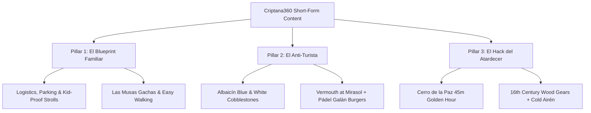

# Criptana360 — TikTok & Short-Form Video Playbook (`TIKTOK_PLAYBOOK.md`)

> **Status**: Active & Enforced  
> **Official Account**: [@criptana360](https://www.tiktok.com/@criptana360) (`https://www.tiktok.com/@criptana360`)  
> **Platform Focus**: TikTok, Instagram Reels, YouTube Shorts  
> **Editorial Standard**: `STRATEGY.md` (Insider Local Voice, Zero Cognitive Load, Mandatory Monetization)  
> **Data Ground Truth**: `assets/js/data.js`

---

## 1. Production Workflow

Our content machine is engineered for speed, high production value, and zero friction. We prioritize authentic, high-end visual rhythm over rigid, talking-head scripts.

### 1.1 The Production Stack

| Tool | Purpose | Workflow Execution |
| :--- | :--- | :--- |
| **Claude / AI Assistant** | Script & Hook Generation | Formats 30-second pacing tables directly referencing spots in `assets/js/data.js` and enforcing `STRATEGY.md`. |
| **CapCut Desktop** | Timeline Assembly & Styling | Uses AutoCut and rhythmic fast-cut templates. Auto-generates captions with highlighted keywords and animated typography. |
| **ElevenLabs** | Voiceover Generation | Premium natural Spanish voiceovers (warm, confident, authentic local pacing). No robotic TTS tones. |

---

### 1.2 The Golden Production Rules

#### Rule 1: Shooting Rule — Never Shoot to Script
- **Do not shoot to a script**. Never try to record long takes or match specific dialogue while on location.
- **Batch-record 5-second B-roll clips**: Walk the village and capture 4K 60fps vertical footage in 5-second chunks.
- **B-roll Shot List to Always Capture**:
  - *Textures & Heritage*: Windmill wooden gears (encina wood), white lime walls (*cal blanca*), cobalt blue baseboards (*zócalos añil*), mill sail canvas fluttering.
  - *Lifestyle & Atmosphere*: Pouring cold Airén white wine, steam rising from fresh gachas, vermouth glass sweating on a marble bar table, footsteps on cobblestone streets.
  - *Light & Drama*: Harsh midday sun glare vs. warm golden hour wrapping around Cerro de la Paz, spotlight beams illuminating the mills at dusk.

#### Rule 2: Scripting Rule — Data-Grounded Insider Voice Only
- **Data Ground Truth**: All spot names, street addresses, hours, and dishes must match `assets/js/data.js` exactly (e.g., *Burleta, Infanto, Sardinero*, *Pósito Real*, *Las Musas*, *Mirasol*, *Pádel Galán*).
- **Insider Local Voice**: Strictly adhere to **Rule 2 of `STRATEGY.md`**. Avoid generic travel clichés ("un lugar mágico", "descubre la historia"). Speak like a trusted local friend sharing non-obvious secrets: when to arrive, what mistake to avoid, which table to request, and what wine to order.
- **Mandatory Monetization Hook**: In accordance with **Rule 3 of `STRATEGY.md`**, every video must direct viewers to a high-intent CTA: the Criptana360 curated weekend guide, hotel affiliate links, or direct restaurant bookings.

---

## 2. Core Content Pillars (The 3 Series)

All short-form video production is categorized into three repeatable, high-engagement content series.

---

### Pillar 1: "El Blueprint Familiar"
- **Strategic Focus**: Logistics, frictionless family travel, zero-stress weekend planning.
- **Core Narrative**: Visiting windmills with kids or family can be exhausting if you arrive at noon and park in the wrong place. This blueprint gives the exact stress-free route.
- **Key Itinerary Anchors** (from `assets/js/data.js`):
  - *Parking*: Park easily behind the Centro de Interpretación Molinos de Viento / Cerro de la Paz.
  - *Walk*: Effortless, flat, stroller-friendly walk past the *Burleta* straight to the *Sardinero*.
  - *Surviving with Kids*: Open space, gentle breeze, no car traffic on the ridge, interactive wooden gear demonstrations.
  - *Culinary Finale*: Traditional, soothing *gachas manchegas* and migas on the family-friendly terrace at **Restaurante Las Musas**.
- **CTA / Conversion Hook**: *"Guarda este vídeo y descarga la ruta familiar completa con mapa de aparcamientos en criptana360.com"*.

---

### Pillar 2: "El Anti-Turista"
- **Strategic Focus**: The hidden route, skipping tourist traps, authentic local lifestyle.
- **Core Narrative**: 90% of tourists arrive on a bus, snap three photos of the mills, and leave. The anti-turista route reveals the secret spots where the locals actually spend their Saturdays.
- **Key Itinerary Anchors** (from `assets/js/data.js`):
  - *The Walk*: Get lost in the maze of the **Barrio del Albaicín**—narrow whitewashed lanes with cobalt blue (*añil*) zócalos, complete silence, zero tour groups.
  - *The Midday Break*: Free, cool refuge in the 16th-century **Pósito Real** with its imperial stone arches.
  - *The Aperitivo*: Traditional vermouth and seasonal tapas with the regulars at **Mirasol**.
  - *The Insider Dinner Secret*: Skip the overpriced tourist menus and head straight to **Pádel Galán** for surprisingly elite smash burgers on buttery brioche.
- **CTA / Conversion Hook**: *"Enlace en bio con la lista secreta de tapeo y el enlace directo para reservar tu hotel rural en Criptana"*.

---

### Pillar 3: "El Hack del Atardecer"
- **Strategic Focus**: Timing, cinematography, sensory contrast, and romance.
- **Core Narrative**: The biggest mistake visitors make is visiting at 13:00 under blinding vertical sun. The entire soul of Criptana reveals itself 45 minutes before sunset.
- **Key Itinerary Anchors** (from `assets/js/data.js`):
  - *The Timing Hack*: Park behind **Cerro de la Paz** exactly 45 minutes before sundown.
  - *The Contrast*: Cut between blinding flat midday white vs. the surreal golden-amber light that illuminates the 500-year-old oak gears of *Burleta*, *Infanto*, and *Sardinero*.
  - *The Climax*: Sitting on the historic stone low-wall as the floodlights kick on against the white lime.
  - *The Pairing*: Walk down three stone steps into **Las Musas** (excavated directly into the cliff rock) for a crisp, icy glass of local **Airén D.O. La Mancha**.
- **CTA / Conversion Hook**: *"Descubre dónde dormir a 5 minutos a pie de este atardecer. Enlace de Booking con cancelación gratis en el perfil"*.

---

## 3. The 30-Second Pacing Formula & Script Template

Every script generated by agents or creators must follow this strict 30-second pacing table format:

| Time | Visual (B-Roll & On-Screen Text) | Audio (SFX & Music) | Voiceover (ElevenLabs Natural Spanish) |
| :--- | :--- | :--- | :--- |
| **0:00 - 0:04** (The Hook) | Fast 2-cut hook. Polarizing visual or unexpected contrast. Big bold center text. | Beat drop or abrupt silence. Cinematic woosh. | Hard-hitting hook statement directly calling out the viewer's mistake or desire. |
| **0:04 - 0:12** (The Setup / Route) | 2–3 rhythmic B-roll cuts (walking feet, street sign, parking spot). | Subtle ambient audio layered with rhythmic lofi / upbeat track. | Clear logistical direction delivered with an insider voice. |
| **0:12 - 0:20** (The Payoff / Experience) | Close-up texture cuts (tapas sizzle, wine pour, mill blades spinning against sky). | ASMR foley (clinking glasses, crunch of gravel, wind). | Vivid, sensory description. Exactly what to do and what to order. |
| **0:20 - 0:26** (The Secret Angle) | Golden hour light or secret venue reveal. | Music swells. | The unexpected twist or local detail that validates the insider tone. |
| **0:26 - 0:30** (The CTA / Monetization) | Clean shot of the viewpoint + overlay of Criptana360 guide / booking prompt. | Final resolving chord. | Concrete, high-intent call to action. |

---

## 4. Production Script Reference Library

### Script 1: Pillar 1 — "El Blueprint Familiar" (30s)

| Time | Visual | Audio | Voiceover |
| :--- | :--- | :--- | :--- |
| **0:00 - 0:04** | [TEXT: Si vas a Criptana con niños, NO hagas esto] Close-up of kid running toward windmill against blue sky. | Wind sound effect + quick bass hit. | "No subas a los molinos a mediodía con el carrito si no quieres que el viaje sea un drama." |
| **0:04 - 0:11** | Quick cut to car parking smoothly behind Centro de Interpretación. Wide shot of flat paved path. | Upbeat, warm acoustic guitar beat. | "Aparca directamente detrás del Centro de Interpretación. Tienes acceso plano, sin cuestas imposibles, directo al molino Sardinero." |
| **0:11 - 0:19** | Kids looking up at the wooden gear inside the mill; blades turning slowly in the breeze. | Sound of wooden creaking gears + joyful laugh. | "Aquí no hay coches ni agobios: espacio abierto, viento limpio y los tres molinos del siglo XVI donde Don Quijote vio gigantes." |
| **0:19 - 0:25** | Steaming pan of traditional gachas manchegas arriving at outdoor terrace of Las Musas. | Sizzle of panceta + cutlery clink. | "Y para rematar sin berrinches: mesa en la terraza de Las Musas con unas gachas manchegas de verdad." |
| **0:25 - 0:30** | Smartphone screen showing Criptana360 interactive map. [TEXT: Link en Bio · Ruta Familiar] | Smooth fade-out tone. | "Tienes la ruta familiar paso a paso y el mapa de parkings gratis en criptana360.com. Enlace en la bio." |

---

### Script 2: Pillar 2 — "El Anti-Turista" (30s)

| Time | Visual | Audio | Voiceover |
| :--- | :--- | :--- | :--- |
| **0:00 - 0:04** | [TEXT: La ruta que el 90% de los turistas no ve] Fast dolly shot walking through narrow white & blue street. | Sharp shutter click + atmospheric indie beat. | "El 90% de los que vienen a Criptana se hacen tres fotos en los molinos y se van. Se están perdiendo lo mejor." |
| **0:04 - 0:11** | High angle of Albaicín cobblestones; extreme close-up of cobalt blue (*añil*) painted wall. | Ambient echo of footsteps on stone. | "Baja hacia el Barrio del Albaicín. Cero autobuses turísticos, solo silencio, cal blanca y zócalos de azul cobalto." |
| **0:11 - 0:18** | Cool stone arches of Pósito Real, followed by a cold glass of vermouth poured at Mirasol. | Clinking ice in glass, ambient bar hum. | "Refúgiate del calor en los arcos del Pósito Real y baja directo a la barra de Mirasol a por un vermut con tapa." |
| **0:18 - 0:25** | Smashed beef patty sizzling on flat top, served on glossy brioche bun at Pádel Galán. | Grill sizzle ASMR. | "Y el secreto mejor guardado: para cenar, ve a Pádel Galán. Sí, un club de pádel con una de las mejores smash burgers de la comarca." |
| **0:25 - 0:30** | Sunset panorama over village rooftops. [TEXT: Guía Secreta + Hoteles en Bio] | Rhythmic finish. | "La guía con los rincones fuera de ruta y los mejores alojamientos rurales la tienes en nuestro perfil." |

---

### Script 3: Pillar 3 — "El Hack del Atardecer" (30s)

| Time | Visual | Audio | Voiceover |
| :--- | :--- | :--- | :--- |
| **0:00 - 0:04** | [TEXT: El error número 1 al visitar Campo de Criptana] Harsh, blinding midday light over asphalt, sudden jump-cut to golden glow. | Muffled heat hum cut off by deep cinematic thud. | "Venir a las doce de la mañana es el mayor error que puedes cometer en Campo de Criptana." |
| **0:04 - 0:11** | Car door shuts. Walk towards Cerro de la Paz as the sun dips low, painting the sky gold and violet. | Slow-building cinematic ambient synth. | "Llega exactamente 45 minutos antes de la puesta de sol y aparca detrás del Cerro de la Paz." |
| **0:11 - 0:19** | Slow-motion glide across the wooden hulls of Burleta, Infanto and Sardinero catching warm light. | Gentle wind roar + crisp stone step sound. | "La luz rasante sobre la piedra caliza transforma la sierra. Ya no hay grupos y los gigantes del siglo XVI parecen flotar sobre la llanura." |
| **0:19 - 0:25** | Wine glass filled with chilled Airén; backdrop of illuminated white windmills as dusk falls. | Pouring wine sound, glass clink. | "Quédate en el murete hasta que enciendan los focos y baja directo a la cueva de Las Musas por un vino Airén bien frío." |
| **0:25 - 0:30** | Panoramic night view with soft lighting. [TEXT: Dónde dormir en Criptana · Link en Bio] | Resolving ambient note. | "Reserva tu fin de semana con cancelación gratis en el enlace del perfil antes de que se agoten las plazas." |

---

## 5. Agent Instructions & Execution Protocol

Any AI agent interacting with this repository must adhere to the following guardrails:
1. When asked for any social script, Reel, or TikTok format, automatically load and cite `TIKTOK_PLAYBOOK.md`.
2. Format the response as a **30-second pacing table** (Time | Visual | Audio | Voiceover).
3. Ensure every script maps to one of the **3 Core Pillars** and incorporates verified data from `assets/js/data.js`.
4. Ensure every script concludes with an unambiguous **Monetization CTA** linking to Criptana360 guides, accommodations, or culinary reservations.
